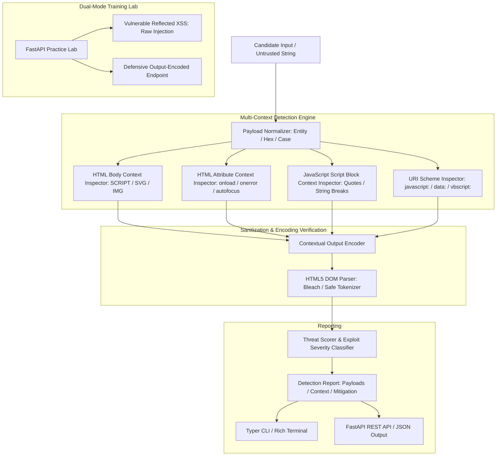

# XSS Detection Lab (`xsslab`)

Enterprise-Grade Cross-Site Scripting (XSS) Detection Engine, DOM Context-Aware Sanitizer, Heuristic Evaluator, and Dual-Mode Practice Lab.

[](https://github.com/Krish9800/xss-detection-lab/actions)
[](LICENSE)
[](https://www.python.org/)
[](https://github.com/mozilla/bleach)
[](https://typer.tiangolo.com/)

---

## Overview & Problem Statement

Cross-Site Scripting (XSS) vulnerabilities (OWASP Top 10 A03:2021) allow adversaries to execute malicious JavaScript in victims' browsers, leading to session hijacking, credential theft, and DOM defacement. Naive blocklists often fail because XSS payloads adapt across distinct rendering contexts (HTML body, attribute values, JavaScript literals, URI attributes).

**XSS Detection Lab** is a context-aware detection engine and dual-mode practice laboratory. It inspects candidate payloads across rendering contexts, verifies contextual output encoding (HTML entities, URI encoding, JavaScript hex escapes), benchmarks detection accuracy, and provides an embedded dual-mode web application demonstrating both vulnerable patterns and hardened defensive mitigations.

---

## Architecture & Data Flow



---

## Verified Features

- **Context-Aware Payload Detection:** Analyzes candidate strings for execution potential across HTML body, HTML attribute, JavaScript variable, and URL scheme contexts.
- **Comprehensive Vector Coverage:**
  - Classic script injection (`<script>alert(1)</script>`).
  - Event-handler triggers (``, `<svg onload=confirm(1)>`).
  - Pseudo-protocol execution (`<a href="javascript:alert(1)">`).
  - Template literal and string breakout attacks (`'-alert(1)-'`).
- **Contextual Output Encoding:** Implements strict sanitization recipes for HTML entities, attribute escaping, and JavaScript unicode escaping.
- **Dual-Mode Practice Lab:** Embedded FastAPI training ground hosting vulnerable endpoints alongside hardened endpoints utilizing modern Content Security Policy (CSP).
- **Performance Benchmark:** Benchmarking suite evaluating detection latency (< 1.5ms per payload) across synthetic datasets.

---

## Technology Stack

- **Runtime:** Python 3.12+
- **DOM & Sanitization:** `bleach` & `html.parser`
- **API Framework:** FastAPI & Uvicorn
- **CLI Framework:** Typer & Rich
- **Quality Gates:** Pytest, Ruff, Mypy Strict, Bandit

---

## Requirements & Installation

```bash
# Clone the repository
git clone https://github.com/Krish9800/xss-detection-lab.git
cd xss-detection-lab

# Create and activate virtual environment
python3 -m venv .venv
source .venv/bin/activate

# Install dependencies
pip install -e .
```

---

## Verified Usage Examples

### 1. Command-Line Interface (CLI)

```bash
# Fast heuristic audit of a candidate payload
xsslab audit ""

# Contextual analysis of a payload within an attribute context
xsslab analyze '" onfocus="alert(1)" autofocus="' --context attribute

# Generate safe contextual output encoding for an untrusted string
xsslab encode "<script>alert('pwned')</script>" --context html

# Run detection latency and accuracy benchmark
xsslab benchmark

# Launch the interactive dual-mode practice lab
xsslab lab --port 8080
```

### 2. REST API Service

```bash
# Launch the XSS detection API
uvicorn xsslab.api.app:app --host 127.0.0.1 --port 8000
```

Endpoints available at `http://127.0.0.1:8000/docs`:
- `GET /health` — Service health check
- `POST /api/v1/audit` — Fast regex pattern audit
- `POST /api/v1/analyze` — Context-aware semantic XSS evaluation
- `POST /api/v1/encode` — Safe contextual encoding utility

---

## Testing & Quality Gates

```bash
# Run unit and contextual sanitization tests
pytest --cov=xsslab --cov-report=term-missing

# Linting and static analysis
ruff check .
ruff format --check .
mypy src/xsslab
```

---

## Security Model & Threat Boundaries

- **In-Memory Parsing:** Evaluates strings purely in memory without rendering in browser web engines, preventing accidental local execution.
- **Defensive Focus:** Provides defensive code snippets demonstrating proper templating engine auto-escaping (Jinja2, React JSX) and strict Content Security Policy headers.

---

## Limitations & Known Issues

- **DOM-Based XSS Limitations:** Evaluates static string payloads; complex client-side source-to-sink DOM execution tracing across minified SPA bundles is best complemented by dynamic browser testing.

---

## License & Responsible Use

This project is licensed under the **MIT License** — see the [LICENSE](LICENSE) file for details.

> [!NOTE]
> Designed for AppSec engineers, web developers learning secure coding, and defensive security researchers.
