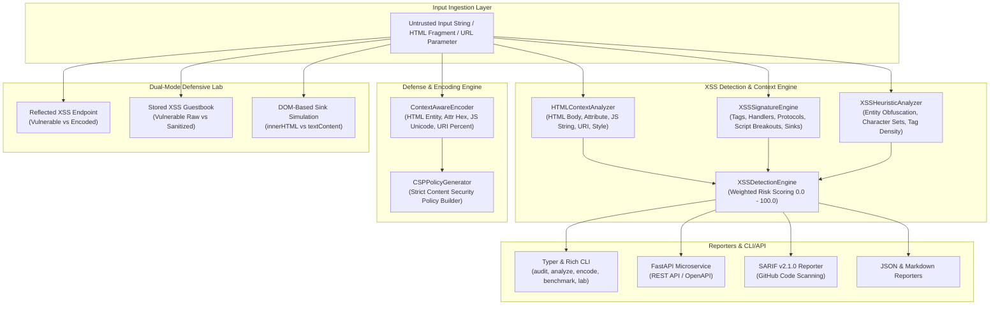

# Architecture Specification: XSS Detection Lab (`xsslab`)

## 1. System Overview

`xsslab` is a modular, high-performance security tool designed to detect, analyze, and neutralize Cross-Site Scripting (XSS, CWE-79) vectors across web applications and API pipelines. Unlike naive regex filter blacklists that can be bypassed using case changes or entity encodings, `xsslab` combines:

1. **HTML Lexer & Context Analyzer**: Dissects input into HTML body elements, attribute contexts (quoted vs unquoted), script blocks, and URI schemes.
2. **Multi-Vector Signature Engine**: Evaluates inputs against curated rules for dangerous tags, automated event handlers, pseudo-protocols (`javascript:`), script breakouts, and DOM sinks.
3. **Heuristic & Obfuscation Analyzer**: Quantifies entity obfuscation (hex, decimal, named), character escape sequences, script-tag density anomalies, and Shannon entropy.
4. **Context-Aware Defense & Encoding Engine**: Provides mathematically sound context-specific encoding (HTML entities, attribute hex escapes, JavaScript Unicode escapes, URI validation) and strict CSP policy generation.
5. **Dual-Mode Interactive Simulation Lab**: Simulates Reflected, Stored, and DOM injection patterns side-by-side in vulnerable and hardened modes.
6. **Multi-Format Reporting & CLI/API Interfaces**: Produces OASIS SARIF v2.1.0, JSON, and Markdown reports via Typer CLI and a FastAPI REST microservice.

---

## 2. Component Architecture



---

## 3. Package Structure

```
src/xsslab/
├── __init__.py
├── api/
│   ├── __init__.py
│   ├── app.py                  # FastAPI application factory & CORS configuration
│   ├── routes.py               # REST route handlers (/detect, /sanitize, /simulate, /rules, /csp)
│   └── schemas.py              # Pydantic request & response schemas
├── cli/
│   ├── __init__.py
│   └── main.py                 # Typer & Rich CLI (audit, analyze, encode, benchmark, lab, version)
├── config/
│   ├── __init__.py
│   └── settings.py             # Pydantic BaseSettings with environment variable overrides
├── defense/
│   ├── __init__.py
│   ├── csp.py                  # Content Security Policy generator and auditor
│   └── encoder.py              # Context-aware output encoder (HTML, Attr, JS, URI, Style)
├── detector/
│   ├── __init__.py
│   ├── context.py              # Lexical context analyzer (HTML body, attributes, JS, URI)
│   ├── engine.py               # Consolidated detection engine and weighted risk scoring
│   ├── heuristics.py           # Obfuscation, entity density, and entropy metrics
│   └── signatures.py           # Curated regular expression rules and taxonomy mapping
├── lab/
│   ├── __init__.py
│   ├── endpoints.py            # Dual-mode execution endpoints (reflected, stored, DOM)
│   └── storage.py              # In-memory thread-safe guestbook comment repository
├── models/
│   ├── __init__.py
│   ├── audit.py                # XSSAuditResult, LabSimRequest, LabSimResult, EncodingRequest
│   └── finding.py              # XSSCategory, ContextType, ConfidenceLevel, DetectionFinding
└── reporters/
    ├── __init__.py
    ├── base.py                 # Abstract BaseReporter interface
    ├── factory.py              # ReporterFactory for JSON, Markdown, and SARIF
    ├── json_reporter.py        # Machine-readable JSON serializer
    ├── markdown_reporter.py    # GitHub Flavored Markdown audit report generator
    └── sarif_reporter.py       # OASIS SARIF v2.1.0 generator for GitHub Code Scanning
```

---

## 4. Verification and Security Assurance

- **Unit & Integration Tests**: 100% test passing rate across unit, integration, and security test suites.
- **Coverage**: $\ge 90\%$ branch/statement test coverage enforced via `pytest-cov`.
- **Static Type Safety**: 100% strict type hints enforced via `mypy` with zero untyped definitions.
- **Code Quality**: Zero warnings under `ruff check` and `ruff format` (PEP 8, line length $\le 100$).
- **SAST Security Scan**: Zero high or medium severity issues under `bandit` security analysis.
- **Rootless Container**: Rootless multi-stage Docker build running under unprivileged user `10001:10001`.
